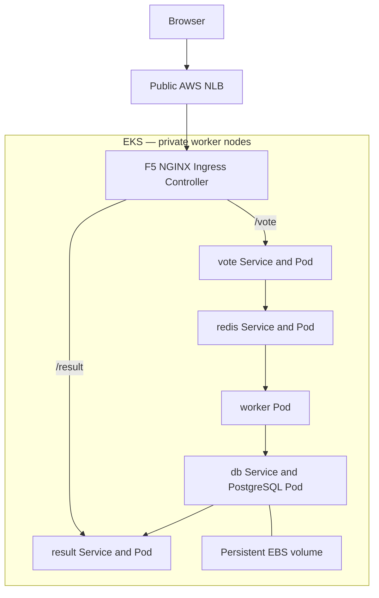

# Project 2 — Voting Application on Amazon EKS

Verified project state: 25 October 2026.

The voting application runs on AWS EKS and is publicly accessible through F5 NGINX Ingress Controller. GitHub Actions builds the three application images, pushes them to Docker Hub, renders their commit-tagged image references into Kubernetes manifests, and applies those manifests.

The infrastructure and application code are kept in two repositories. Use the **eks-deployment** branch in both.

## 1. Repositories and working folders

| Purpose | GitHub repository | Mac folder |
|---|---|---|
| Application, Dockerfiles, Kubernetes, Helm values, CI/CD | [eks-voting-app](https://github.com/shadishirazi68/eks-voting-app/tree/eks-deployment) | /Users/shadi/OrbStack/ubuntu/home/shadi/eks-voting-app |
| AWS infrastructure, network rules, IAM roles, EKS access | [eks-quick-terraform](https://github.com/shadishirazi68/eks-quick-terraform/tree/eks-deployment) | /Users/shadi/eks-quick-terraform |

Commands below run on the **Mac**, which acts as the control computer. Terraform and kubectl communicate with AWS; application containers run on AWS worker nodes.

Terraform uses the local **shadi** workspace. Its state is stored at:
`/Users/shadi/eks-quick-terraform/terraform.tfstate.d/shadi/terraform.tfstate`.

Keep this state. GitHub contains the code, not the local Terraform state. A new clone does not automatically know about resources that already exist in AWS.

## 2. Architecture

- Region: **us-east-1**.
- Cluster: **eks-shadi**, Kubernetes **1.36**.
- Two managed **t3.medium**, ON_DEMAND, x86 worker nodes in private subnets across two availability zones.
- Public subnets contain the internet-facing Network Load Balancer. A single NAT Gateway provides outbound access from private subnets.
- AWS manages the EKS control plane. Kubernetes schedules application Pods onto the worker nodes.
- Namespace: **voting-app**.
- Five application Deployments, initially one replica each: vote, result, worker, redis, and db.
- PostgreSQL uses an encrypted **8 GiB gp3 EBS** volume through a PersistentVolumeClaim.
- AWS Load Balancer Controller manages the public NLB. F5 NGINX Ingress Controller routes HTTP requests to the application.

The diagram shows logical traffic and data flow; Pods may move between worker nodes.



### Component responsibilities

| Component | Responsibility | Port |
|---|---|---|
| vote | Flask interface; sends votes to Redis | 80 |
| redis | Temporary queue for incoming votes | 6379 |
| worker | Reads Redis and writes votes to PostgreSQL | No incoming application port |
| db | Stores votes | 5432 |
| result | Reads database results and displays updates | 80 |

The worker does not need a Kubernetes Service because the application does not send incoming requests to it. Its outbound connections use the redis and db Services.

## 3. Public access

The verified endpoint on 25 October was:

- [Vote](http://k8s-nginxing-nginxing-335d94f03d-ae5c0ea7f7c03815.elb.us-east-1.amazonaws.com/vote)
- [Result](http://k8s-nginxing-nginxing-335d94f03d-ae5c0ea7f7c03815.elb.us-east-1.amazonaws.com/result)

These are HTTP endpoints. HTTPS and a custom domain have not been configured.

After a rebuild, obtain the new hostname rather than reusing this example.

**Mac — application folder.** The Ingress and Helm values are stored here.

```bash
cd /Users/shadi/OrbStack/ubuntu/home/shadi/eks-voting-app
kubectl --context eks-shadi get service nginx-ingress-controller -n nginx-ingress
kubectl --context eks-shadi get ingress -n voting-app
```

Open http://NEW_HOSTNAME/vote and http://NEW_HOSTNAME/result. The host in k8s/ingress.yaml must match the new hostname before that Ingress is applied.

## 4. Files added or changed for Project 2

### Infrastructure repository

| File | Purpose |
|---|---|
| main.tf | VPC, EKS, node group, add-ons, EBS identity, and HTTP security-group rule |
| load-balancer-controller.tf | Pod Identity role and association for AWS Load Balancer Controller |
| aws-load-balancer-controller-iam-policy.json | Controller IAM permissions |
| github-actions.tf | GitHub OIDC deployment role, DescribeCluster permission, EKS access entry |
| .terraform.lock.hcl | Provider version selections and checksums |
| .gitignore | Excludes Terraform state, plans, caches, and local variable files |

### Application repository

| File | Purpose |
|---|---|
| k8s/namespace.yaml | Creates voting-app |
| k8s/storage.yaml | gp3 StorageClass |
| k8s/postgres.yaml | Database Deployment, Service, and PVC |
| k8s/redis.yaml | Redis Deployment and Service |
| k8s/vote.yaml | Vote Deployment and Service |
| k8s/result.yaml | Result Deployment and Service |
| k8s/worker.yaml | Worker Deployment |
| helm/nginx-values.yaml | NGINX settings and public NLB configuration |
| k8s/ingress.yaml | Routes /vote and /result; enables result WebSockets |
| k8s/github-actions-rbac.yaml | Deployment Role and RoleBinding |
| k8s/kustomization.yaml | Selects application Deployments, Services, PVC, and Ingress for CI deployment |
| .github/workflows/build-images.yml | Image build, push, manifest rendering, validation, and application |

The db-secret Kubernetes Secret is created separately. Its password is not stored in these manifests.

## 5. CI/CD

Workflow trigger: a push to **eks-deployment** in **shadishirazi68/eks-voting-app**.

1. Three parallel jobs build vote, result, and worker for linux/amd64.
2. Each image is pushed to Docker Hub with the full Git commit SHA as its tag.
3. Deployment waits for all three builds to succeed.
4. GitHub obtains temporary AWS credentials through OIDC.
5. AWS CLI creates the runner's kubeconfig for eks-shadi.
6. Kustomize renders the application manifests with vote, result, and worker images tagged with that same commit SHA.
7. A server-side dry run validates the rendered manifests before changes are applied.
8. kubectl apply creates or updates the five Deployments, four Services, database PVC, and Ingress.
9. The job waits for all five Deployment rollouts to succeed.

Image format: **shadshad/eks-COMPONENT:COMMIT_SHA**.

### GitHub configuration

**Browser — application repository settings.** No local folder or terminal is needed.

Settings → Secrets and variables → Actions:

| Kind | Name | Purpose |
|---|---|---|
| Repository secret | DOCKERHUB_USERNAME | Docker Hub account name |
| Repository secret | DOCKERHUB_TOKEN | Docker Hub token with push permission |
| Repository variable | AWS_ROLE_ARN | arn:aws:iam::686699774218:role/github-actions-eks-shadi |

No long-lived AWS access key is stored in the workflow.

The existing account-level GitHub OIDC provider is read through a Terraform data source. Terraform does not create or own that shared provider. The role trust is restricted to this application's eks-deployment branch and includes its GitHub owner and repository IDs.

EKS maps the role to the **github-actions-deployers** group. A namespace RoleBinding grants it permission to get, create, and patch application Deployments, Services, PVCs, and Ingresses inside voting-app, and to monitor Deployments and Pods. It has no permission to manage Secrets, RBAC, Namespaces, or StorageClasses.

The workflow applies the namespaced runtime resources selected by k8s/kustomization.yaml. Terraform, Helm controllers, Namespace, gp3 StorageClass, db-secret, and deployment RBAC remain bootstrap steps. CI does not grant its own permissions. The updated RBAC must first be applied from the administrator's Mac terminal. The pipeline checks image builds, server-side manifest validation, and rollout success; it does not run a separate automated unit or application integration test suite.

### Previously verified deployment

- Application commit/image tag: **24569c19ac5c574d7cdd51434c8e8cf0bc452a1d**.
- [Previously successful image-update deployment run](https://github.com/shadishirazi68/eks-voting-app/actions/runs/40193297222).
- After switching to manifest application, record the new successful workflow run and confirm its Apply Kubernetes manifests step passed.
- All three deployed image tags matched this commit.
- Browser screenshots showed the vote total changing from 11 to 16 and the result percentages updating.

The current workflow triggers on every push to eks-deployment, including documentation changes. Add-ons such as HTTPS are deferred and are not included in this change.

## 6. Verify the running application

**Mac — application folder.** These commands inspect Kubernetes; they do not rebuild infrastructure.

```bash
cd /Users/shadi/OrbStack/ubuntu/home/shadi/eks-voting-app
kubectl --context eks-shadi get nodes
kubectl --context eks-shadi get deployments,pods,services -n voting-app
kubectl --context eks-shadi get pvc -n voting-app
kubectl --context eks-shadi get deployments vote result worker -n voting-app -o 'custom-columns=NAME:.metadata.name,IMAGE:.spec.template.spec.containers[0].image'
```

Expected: nodes Ready, application Deployments available, Pods Running and ready, and the database PVC Bound. Check that all three custom application images use the intended commit tag.

**Browser — public application URLs.** Open both pages, cast votes, and confirm that the total and percentages update. This tests the application flow beyond Kubernetes rollout readiness.

## 7. Rebuild checklist

This is reference material for a future rebuild. The currently verified deployment does not need to be recreated.

### A. Recreate infrastructure

**Mac — infrastructure folder.** The wrapper selects the student's Terraform workspace, applies AWS configuration, updates kubeconfig, and waits for nodes.

```bash
cd /Users/shadi/eks-quick-terraform
git switch eks-deployment
AWS_REGION=us-east-1 ./up.sh shadi
```

The wrapper automatically approves Terraform apply. Use the canonical folder and the correct state when managing an existing cluster.

Prerequisites: valid AWS credentials, Terraform, AWS CLI, kubectl, Helm, and the account-level GitHub OIDC provider referenced by github-actions.tf.

### B. Install the controllers

**Mac — application folder.** Controller Helm values are stored in this repository.

```bash
cd /Users/shadi/OrbStack/ubuntu/home/shadi/eks-voting-app
VOTING_VPC_ID="$(aws eks describe-cluster --name eks-shadi --region us-east-1 --query cluster.resourcesVpcConfig.vpcId --output text --no-cli-pager)"

helm repo add eks https://aws.github.io/eks-charts
helm repo update eks

helm upgrade --install aws-load-balancer-controller eks/aws-load-balancer-controller \
  --kube-context eks-shadi --namespace kube-system --version 3.6.2 \
  --set clusterName=eks-shadi --set region=us-east-1 \
  --set vpcId="$VOTING_VPC_ID" \
  --set serviceAccount.create=true \
  --set serviceAccount.name=aws-load-balancer-controller \
  --wait --timeout 5m

helm upgrade --install nginx-ingress oci://ghcr.io/nginx/charts/nginx-ingress \
  --kube-context eks-shadi --namespace nginx-ingress --create-namespace \
  --version 2.8.0 --values helm/nginx-values.yaml \
  --wait --timeout 10m
```

These are the versions used in this lab: AWS controller chart 3.6.2 and F5 NGINX chart 2.8.0, controller 5.7.0. The controller IAM policy and Pod Identity association come from Terraform.

### C. Bootstrap a fresh application's database and workloads

**Mac — application folder.** Run this only for a fresh namespace and empty database volume.

```bash
kubectl --context eks-shadi apply -f k8s/namespace.yaml
DB_PASSWORD="$(openssl rand -hex 24)"
kubectl --context eks-shadi create secret generic db-secret \
  --namespace voting-app --from-literal=password="$DB_PASSWORD"
unset DB_PASSWORD

kubectl --context eks-shadi apply -f k8s/storage.yaml
kubectl --context eks-shadi apply -f k8s/redis.yaml
kubectl --context eks-shadi apply -f k8s/postgres.yaml
kubectl --context eks-shadi apply -f k8s/vote.yaml
kubectl --context eks-shadi apply -f k8s/result.yaml
kubectl --context eks-shadi apply -f k8s/worker.yaml
kubectl --context eks-shadi apply -f k8s/github-actions-rbac.yaml
```

Do not replace the Secret with a new random password while retaining an already initialized PostgreSQL volume. Its database password must match.

Wait for the NGINX Service to receive a hostname. Update the host value in k8s/ingress.yaml to match, then apply it from the same application folder:

```bash
kubectl --context eks-shadi get service nginx-ingress-controller -n nginx-ingress
kubectl --context eks-shadi apply -f k8s/ingress.yaml
```

Initial application manifests use the v1 image tags. A subsequent successful workflow deploys commit-tagged images. Reapplying those manifests later can restore v1, so account for this when making manual manifest changes.

## 8. Troubleshooting: public pages returned 504

**Symptom:** /vote and /result timed out while the application Pods were healthy.

**Evidence:** NGINX logs reported timeouts while connecting to application Pod IPs on TCP 80. NGINX was on one worker node and the target application Pods were on the other.

**Cause:** The node security group allowed self traffic on DNS and high ports but did not allow TCP 80 from the same node security group. Existing HTTP rules for a load-balancer security group did not cover NGINX-to-application traffic.

**Fix:** Add this node security-group rule inside the EKS Terraform module, then plan and apply it from the infrastructure folder.

```hcl
node_security_group_additional_rules = {
  ingress_http_between_nodes = {
    description = "Allow HTTP between nodes for application pods"
    protocol    = "tcp"
    from_port   = 80
    to_port     = 80
    type        = "ingress"
    self        = true
  }
}
```

**Result:** Both public pages opened and votes updated the results. The rule is committed in main.tf.

## 9. Git troubleshooting and repository ownership

A fork creates a repository under your GitHub account. A clone creates a local working copy. A commit saves local Git history. A push uploads commits.

The infrastructure push initially failed because its destination fork was not available. After creating the infrastructure fork, the local commit could be uploaded.

A second source of confusion was running git push from the application folder. Git uses the repository belonging to its current folder.

**Mac — any current folder.** Use -C to explicitly select the infrastructure repository:

```bash
git -C /Users/shadi/eks-quick-terraform push -u origin eks-deployment
git -C /Users/shadi/eks-quick-terraform status
```

The infrastructure fork's origin points to shadishirazi68/eks-quick-terraform. Its upstream points to professordiogodev/eks-quick-terraform.

"Working tree clean" means local changes are committed; it does not prove that a push succeeded. GitHub's printed "Create a pull request" URL is an optional suggestion and does not itself open a PR.

The earlier application PR to the teacher's repository was closed unmerged. That PR did not merge the proposed changes into the teacher's main branch.

## 10. Cleanup and cost control

For a future shutdown of this dedicated lab cluster, first preserve any database data you need. Cleanup deletes workloads, PVCs, and their EBS storage, so a rebuild starts with fresh application data.

**Mac — infrastructure folder.** Run only when ready to shut the lab down:

```bash
cd /Users/shadi/eks-quick-terraform
AWS_REGION=us-east-1 ./down.sh shadi
```

The script cleans up Kubernetes-created load balancers and volumes while controllers still run, then destroys Terraform-managed resources and removes the student's workspace.

After completion, check the lab's EKS cluster, EC2 nodes, NLB, NAT Gateway, allocated public IPs, and EBS volumes for leftovers. Terraform destruction alone is not evidence that every controller-created AWS resource was removed.

A future up.sh run recreates Terraform-managed infrastructure. Reinstall the controllers and application resources using the rebuild steps above; application data is not restored automatically.

## 11. Evidence to keep for the presentation

| Evidence | Suggested caption |
|---|---|
| EKS nodes and application Pods | Two worker nodes running the voting application workloads |
| PVC Bound | PostgreSQL uses persistent gp3 EBS storage |
| NGINX timeout logs | Healthy Pods but failed connections through Ingress |
| Terraform self TCP 80 rule | Node security-group rule restores cross-node HTTP access |
| Green build and deployment jobs | GitHub Actions builds and deploys all three application images |
| Deployment image tags | EKS runs images tagged with the workflow commit SHA |
| Vote and Result pages before/after voting | Public application test confirms votes reach the results page |
| Infrastructure push and clean status | Infrastructure changes saved in the user's GitHub fork |

## 12. Current limits and possible extensions

This is a working classroom deployment. Current limits include HTTP-only access, single replicas for application components, one NAT Gateway, and no configured database backup/restore workflow.

Possible later extensions include a custom domain with HTTPS, automated application tests, backup/restore, stronger availability, and a manifest-based image-version update process.

## Sources

- [Application source and Kubernetes configuration](https://github.com/shadishirazi68/eks-voting-app/tree/eks-deployment).
- [Infrastructure source](https://github.com/shadishirazi68/eks-quick-terraform/tree/eks-deployment).
- [Verified GitHub Actions deployment](https://github.com/shadishirazi68/eks-voting-app/actions/runs/40193297222).
- Terminal and browser evidence supplied during this project session.

